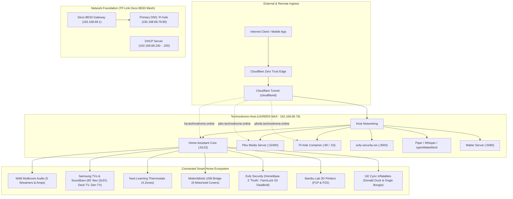

# Technodrome & 1112 Smart Home Infrastructure

Comprehensive architecture, disaster recovery runbooks, network configuration, and service deployment documentation for the **Technodrome** home lab and **1112** smart home ecosystem.

---

## 🏛️ System Architecture

---

## 🌐 External & Remote Access Endpoints

All external traffic routes securely via Cloudflare Tunnels with TLS termination. No public router ports are forwarded.

| Service | Public URL | Internal Target | Authentication / Access |
| :--- | :--- | :--- | :--- |
| **Home Assistant** | [`https://ha.technodrome.online`](https://ha.technodrome.online) | `http://127.0.0.1:8123` | HA Auth (Trusted Reverse Proxy) |
| **Plex Media Server** | [`https://plex.technodrome.online/web`](https://plex.technodrome.online/web) | `http://127.0.0.1:32400` | Plex OAuth / Plex Pass |
| **Pi-hole Admin** | [`https://pihole.technodrome.online/admin`](https://pihole.technodrome.online/admin) | `http://127.0.0.1:80` | Pi-hole Admin Password |

---

## 📚 Documentation Index

| Document | Purpose & Contents |
| :--- | :--- |
| **[`docs/network-architecture.md`](docs/network-architecture.md)** | Deco BE63 Wi-Fi 7 topology, subnet layout, DNS architecture, `.lan` client mappings, and Cloudflare Tunnel config. |
| **[`docs/technodrome-nas-docker.md`](docs/technodrome-nas-docker.md)** | UGREEN NAS hardware specs, storage pools, volume layout, and Docker Compose configurations for all services. |
| **[`docs/home-assistant-config.md`](docs/home-assistant-config.md)** | Reverse proxy trust (`.storage/http`), integrations (WiiM, Nest, Eufy, Motionblinds), automations, scripts, and dashboards. |
| **[`docs/device-ip-inventory.md`](docs/device-ip-inventory.md)** | Complete 50-device inventory with IP addresses, MACs, hostnames, connection mediums, and physical locations. |
| **[`docs/disaster-recovery-runbook.md`](docs/disaster-recovery-runbook.md)** | Step-by-step complete disaster recovery runbook to rebuild the entire environment from bare metal if drives or data are lost. |
| **[`docker/`](docker/)** | Production-ready `docker-compose.yml` templates for deploying services on Technodrome. |

---

## ⚡ Key Highlights & Custom Automations

* **🎵 WiiM Whole-Home Multiroom Hub**: 
  * 5 WiiM devices (Lounge Ultra, Lounge Amp, Den Ultra, Den Amp, Deck Speakers).
  * 1-tap **Party Mode** synchronization, master volume scaling, and individual zone toggles.
  * Dedicated native dashboard at `https://ha.technodrome.online/wiim-audio`.
* **📺 Deck Entertainment Sync**:
  * Powering on the Deck TV automatically sets the Deck Speakers WiiM Amp to **TV audio** and un-mutes playback.
* **🎃 Front Yard Inflatables Twilight Timer**:
  * Front yard GE Cync smart plugs (`switch.donald_duck`, `switch.oogie_boogie`) automatically inflate at sunset and deflate at 12:30 AM.
  * Built-in weather safety cutoff shuts them off if wind speeds exceed 25 mph or severe rain hits, with a manual override switch.
* **🌙 1-Tap Nighttime Lockdown**:
  * Single bedtime button (and 11:30 PM schedule) that closes 9 Motionblinds, shuts down all TVs and audio, sets the Bedroom Thermostat to 68°F sleep temp, arms Eufy HomeBase 3 to `Home`, verifies deadbolt lock status, and logs a garage door reminder.
* **🖥️ Technodrome Hardware Monitoring**:
  * Real-time monitoring of UGREEN NAS CPU temperature, CPU utilization %, RAM usage %, disk space, and network I/O on a dedicated system card.
