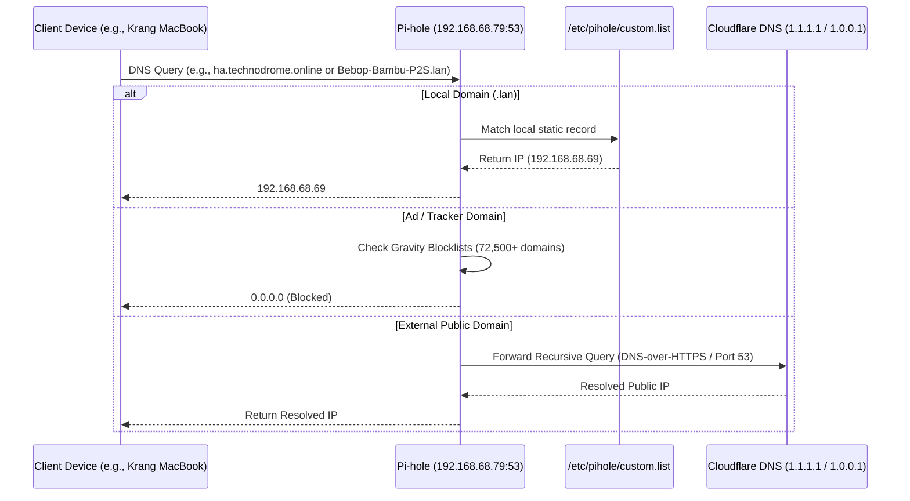

# Network Architecture & DNS Design

This document details the physical and logical networking configuration for the **1112** residence and the **Technodrome** server, including router settings, DHCP allocations, Pi-hole DNS ad-blocking, local hostname resolution, and Cloudflare Zero Trust ingress.

---

## 1. Network Topology & Hardware

```mermaid
flowchart TD
    WAN["Fiber / ISP Modem"] --> DecoMain["Deco BE63 Main Gateway (192.168.68.1)\nLiving Room"]
    
    subgraph MeshBackhaul ["Wi-Fi 7 / 2.5 Gbps Mesh"]
        DecoMain <--> DecoOffice["Deco BE63 Satellite\nOffice"]
        DecoMain <--> DecoFamily["Deco BE63 Satellite\nFamily Room / Garage"]
    end

    DecoMain -->|2.5 Gbps Ethernet| Switch["Unmanaged Multi-Gig Switch (TL-SG108E)"]
    Switch -->|2.5 Gbps Ethernet| Technodrome["Technodrome NAS (192.168.68.79)\nUGREEN DXP4800 Plus"]
    Switch -->|1 Gbps Ethernet| Dock["Krang CalDigit TS4 Dock (192.168.68.85)"]
    Switch -->|1 Gbps Ethernet| TV["85' Neo QLED TV (192.168.68.91)"]
    Switch -->|1 Gbps Ethernet| Soundbar["Lounge Soundbar (192.168.68.81)"]

    DecoMain -.->|Wi-Fi 7 (6 GHz / 5 GHz)| Krang["Krang MacBook Pro (192.168.68.77)"]
    DecoMain -.->|Wi-Fi (5 GHz)| WiiM["WiiM Streamers & Amps"]
    DecoMain -.->|2.4 GHz IoT SSID| SmartHome["Nest Thermostats, Cync Plugs, Bambu Printers"]
```

### Hardware Specifications
* **Primary Gateway / Mesh**: 3x TP-Link Deco BE63 (Wi-Fi 7, Tri-Band BE10000, 4x 2.5 Gbps ports per node).
* **Switching**: TP-Link TL-SG108E 8-Port Gigabit/Multi-Gig Easy Smart Switch.
* **Core Host**: UGREEN DXP4800 Plus (`192.168.68.79`) with dual 2.5 GbE interfaces.

---

## 2. IP Subnetting & Addressing Plan

| Parameter | Value | Notes |
| :--- | :--- | :--- |
| **Subnet** | `192.168.68.0/24` | Class C private network |
| **Netmask** | `255.255.255.0` | 254 usable host addresses |
| **Gateway** | `192.168.68.1` | Deco BE63 Main Router |
| **DHCP Dynamic Pool** | `192.168.68.100` – `192.168.68.250` | Assigned to guests and transient devices |
| **Static / Reserved Pool** | `192.168.68.2` – `192.168.68.99` | Static DHCP IP bindings configured in Deco App |
| **DNS Server (DHCP Option 6)** | `192.168.68.79` | Points all network devices directly to Pi-hole |
| **Local Search Domain** | `.lan` | Resolves clean names (e.g. `technodrome.lan`) |

---

## 3. DNS Resolution Architecture (Pi-hole)



### Pi-hole Configuration Parameters
* **Container**: `pihole` running on Technodrome (`/volume1/docker/pihole`).
* **Ports**: `53/tcp`, `53/udp` (DNS), `80/tcp` (Web Admin interface).
* **Upstream DNS Servers**:
  * `1.1.1.1` (Cloudflare Primary)
  * `1.0.0.1` (Cloudflare Secondary)
* **Conditional Forwarding**: Disabled (all static devices defined explicitly in local DNS table to prevent DHCP lease loops).

### Key Local Static DNS Records (`/etc/pihole/custom.list`)
```text
192.168.68.79  technodrome.lan technodrome
192.168.68.77  Krang-MacBook-Pro.lan Krang
192.168.68.88  Krang-Wired.lan
192.168.68.85  Krang-Dock.lan
192.168.68.91  85-Neo-QLED-TV.lan
192.168.68.81  Lounge-Soundbar.lan
192.168.68.80  Bryans-Watch.lan
192.168.68.69  Bebop-Bambu-P2S.lan
192.168.68.65  Rocksteady-Bambu-P1P.lan
192.168.68.87  Lounge-Thermostat.lan
192.168.68.89  Bedroom-Thermostat.lan
192.168.68.86  Living-Room-Thermostat.lan
192.168.68.84  Amandas-Office-Thermostat.lan
192.168.68.55  Motionblinds-Bridge.lan
```

---

## 4. Cloudflare Zero Trust Remote Ingress

Remote access to Home Assistant, Plex, and Pi-hole is established entirely through an encrypted outbound **Cloudflare Tunnel** (`cloudflared`).

### Security Advantages
1. **Zero Open Ports**: No router port forwarding (NAT 80/443 closed to public scans).
2. **DDoS Protection**: Traffic routes through Cloudflare's edge proxy network.
3. **Automated SSL/TLS**: Cloudflare manages modern edge certificates for `*.technodrome.online`.
4. **WebSocket Support**: Full persistent HTTP/2 and WebSocket transport for real-time Home Assistant frontend updates.

### Tunnel Routing Ingress Rules
| Public Hostname | Service Protocol | Internal Destination | Notes |
| :--- | :--- | :--- | :--- |
| `ha.technodrome.online` | HTTP | `http://127.0.0.1:8123` | Home Assistant Core (Requires trusted reverse proxy configuration) |
| `photos.technodrome.online` | HTTP | `http://127.0.0.1:2283` | Immich Photo & Video Server |
| `grafana.technodrome.online` | HTTP | `http://127.0.0.1:3001` | Grafana Observability Dashboards (Password Protected) |
| `plex.technodrome.online` | HTTP | `http://127.0.0.1:32400` | Plex Media Server |
| `pihole.technodrome.online` | HTTP | `http://127.0.0.1:80` | Pi-hole Admin Web Interface |
| `*` | HTTP status | `404` | Catch-all reject rule |
