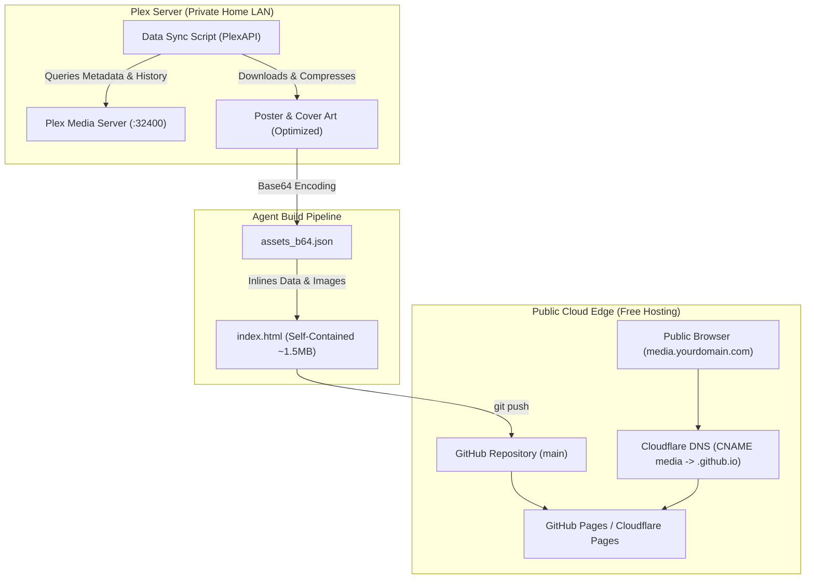

# Agent Implementation Guide: Autonomous Plex Media Vault & Year-End Wrapped Setup

This guide is designed as a complete, self-contained handoff prompt that you can give to an AI coding assistant or agent (such as Antigravity, Claude, or ChatGPT) to replicate this exact setup for any Plex server from scratch.

> [!IMPORTANT]
> All personal details, IP addresses, server names, tokens, and domain credentials have been sanitized and replaced with clear `<PLACEHOLDERS>`.

---

## 🎯 Target System Architecture

The resulting project consists of:
1. **Automated Data Harvester (`sync_data.py`)**: Connects to the user's Plex server via the Plex API, queries movies, music albums, tracklists, watch history, and device statistics.
2. **Asset Optimizer & Base64 Inliner**: Downloads artwork directly from Plex, optimizes images to 500px, and converts them to inline Base64 data URIs so the entire site is a single, zero-dependency, portable HTML file.
3. **Public Web Dashboard (`index.html`)**:
   * **Informative Only**: No media playback, no streaming ports, no software versions, zero server telemetry leaks.
   * **Cinema & Music Catalog**: Searchable, filterable by genre, with modal drawers for tracklists and cast details.
   * **Monthly Top Charts**: Dropdown month selector, top tracks leaderboard, listening minutes, and device breakdown.
   * **Year-End Wrapped (Spotify Wrapped style)**: Fullscreen interactive multi-slide story mode with auto-progress bars and keyboard navigation.
4. **Automated Deployment**: Hosted on **GitHub Pages** (or Cloudflare Pages) at a custom subdomain (`media.<your-domain>.com`) with automated SSL.

---



---

## 📋 Handoff Prompt for the Agent

*Copy and paste the prompt below directly into the agent:*

````markdown
You are tasked with building and deploying an informative, elegant web dashboard for my Plex media collection, complete with Monthly Top Lists and a Spotify-style Year-End Wrapped experience.

Please follow these 5 phases:

### Phase 1: Connect to Plex & Discover Libraries
1. Install `plexapi` in Python: `pip install plexapi Pillow`.
2. Connect using my Plex credentials:
   - Plex URL: `http://<YOUR_PLEX_IP_OR_HOSTNAME>:32400`
   - Plex Token: `<YOUR_PLEX_TOKEN>` (Found in Plex Web > View XML > `X-Plex-Token`)
3. Inspect available libraries (e.g., Movies, Music) and retrieve total item counts, audio formats (FLAC vs AAC), and user watch statistics.

### Phase 2: Harvest Metadata & Optimize Artwork
1. Extract detailed metadata for all movies (title, year, resolution, codec, duration, synopsis, directors, cast).
2. Extract all albums and tracks (album title, artist, year, genre, format, play count, full tracklist with durations).
3. Extract recent playback history and user device listening statistics (total duration, top devices).
4. Download poster and album art images from Plex:
   - Resize all images to max 500px on the longest dimension (using Pillow or macOS `sips`) to keep sizes small (~30-60 KB each).
   - Base64-encode all images into a JSON lookup dictionary: `{"Album_poster.jpg": "data:image/jpeg;base64,..."}`.

### Phase 3: Build the Self-Contained Frontend (`index.html`)
Build a single-file, production-grade `index.html` styled with Tailwind CSS (using `<script src="https://www.gstatic.com/antigravity/web/dev/tailwindcss.min.js"></script>`).

Key Functional & Design Requirements:
1. **Self-Contained**: Inline all Base64 images and JSON datasets directly into the HTML file. No external image URLs or relative disk paths that could break under `file://` or CORS restrictions.
2. **Informative Only (No Media Playback)**:
   - Do NOT include audio players, scrubber bars, or play buttons (`▶`).
   - Tracklists and tables should display durations and ranks, not play controls.
3. **Privacy & Security Sanitization**:
   - Do NOT display Plex version numbers, OS/Linux kernel versions, internal IP addresses, local paths (`/movies`), or port numbers (`32400`).
   - Header should read cleanly (e.g. `"<YOUR_VAULT_NAME> — Curated Media Archives & Analytics"`).
4. **Sections to Include**:
   - **Hero & Search**: Live instant search across titles, artists, actors, and genres.
   - **Catalog Tabs**: "All Media", "Monthly Top Lists", "Cinema", "Music", "Recent Activity".
   - **Monthly Top Charts**: Month dropdown switcher, top tracks leaderboard, listening minutes, and client/device breakdown meters.
   - **Modal Drawers**: Clicking movies or albums opens modal drawers with full synopses, cast chips, and complete tracklists with track numbers and durations.
   - **Interactive Year-End Wrapped**: A fullscreen multi-slide modal with auto-advancing progress bars and keyboard arrow navigation:
     - Slide 1: Welcome & Total Minutes Streamed
     - Slide 2: Top Artist of the Year (with crown badge)
     - Slide 3: Top 5 Songs Leaderboard
     - Slide 4: Audiophile Rating (% Lossless FLAC streams)
     - Slide 5: Sonic Persona / Archetype
     - Slide 6: Summary & Freeze date reminder (e.g., Dec 20)

### Phase 4: Automation Script
Create a standalone Python script `scripts/sync_wrapped.py` that can re-query Plex statistics, update the monthly/annual numbers, and be automated via cron to lock in the final stats on December 20.

### Phase 5: Deploy to GitHub Pages with Custom Domain
1. Commit `index.html` and push to the GitHub repository.
2. Enable GitHub Pages on branch `main` (`/ root`).
3. Configure the custom domain (`media.<your-domain>.com`) with automatic HTTPS.
````

---

## 🛠️ Step-by-Step Implementation Details

### Step 1: Python Extraction Script (`scripts/harvest_plex.py`)

Here is the exact reference script the agent should use to extract data and compile Base64 assets:

```python
import os
import json
import base64
from io import BytesIO
from PIL import Image
from plexapi.server import PlexServer

PLEX_URL = "http://127.0.0.1:32400"  # Replace with Plex IP
PLEX_TOKEN = "YOUR_PLEX_TOKEN"       # Replace with your token

plex = PlexServer(PLEX_URL, PLEX_TOKEN)

# 1. Extract Movies
movies_data = []
movies_lib = plex.library.section('Movies')
for m in movies_lib.all():
    poster_filename = f"{m.ratingKey}_poster.jpg"
    movies_data.append({
        "id": m.ratingKey,
        "title": m.title,
        "year": m.year,
        "rating": m.contentRating or "NR",
        "duration": f"{m.duration // 60000}m" if m.duration else "Unknown",
        "resolution": "1080p",
        "codec": m.media[0].videoCodec.upper() if m.media else "H.264",
        "director": m.directors[0].tag if m.directors else "Unknown",
        "summary": m.summary,
        "cast": [a.tag for a in m.actors[:6]],
        "poster_key": poster_filename
    })
    # Save optimized poster
    thumb_url = m.thumbUrl
    img_data = plex._session.get(thumb_url).content
    im = Image.open(BytesIO(img_data))
    im.thumbnail((500, 500))
    im.save(f"assets/{poster_filename}", "JPEG", quality=85)

# 2. Extract Music Albums
albums_data = []
music_lib = plex.library.section('Music')
for album in music_lib.albums():
    poster_filename = f"{album.ratingKey}_poster.jpg"
    tracks = []
    for t in album.tracks():
        duration_s = (t.duration or 0) // 1000
        mins, secs = divmod(duration_s, 60)
        tracks.append({
            "num": t.index,
            "title": t.title,
            "duration": f"{mins:02d}:{secs:02d}"
        })
    
    albums_data.append({
        "id": album.ratingKey,
        "title": album.title,
        "artist": album.parentTitle,
        "year": album.year,
        "genre": album.genres[0].tag if album.genres else "Music",
        "format": "FLAC",
        "plays": album.viewCount or 0,
        "summary": album.summary,
        "tracks": tracks,
        "poster_key": poster_filename
    })
    # Save optimized cover
    thumb_url = album.thumbUrl
    img_data = plex._session.get(thumb_url).content
    im = Image.open(BytesIO(img_data))
    im.thumbnail((500, 500))
    im.save(f"assets/{poster_filename}", "JPEG", quality=85)

# 3. Compile Base64 Map
b64_map = {}
for fname in os.listdir("assets"):
    if fname.endswith(".jpg"):
        with open(f"assets/{fname}", "rb") as f:
            b64_map[fname] = f"data:image/jpeg;base64,{base64.b64encode(f.read()).decode('utf-8')}"

with open("assets_b64.json", "w") as f:
    json.dump(b64_map, f)
```

---

### Step 2: Cloudflare & DNS Configuration

If the user owns their domain through Namecheap, Google, or GoDaddy, but uses **Cloudflare** for DNS:

1. **Do not add records at Namecheap.** Point all records in Cloudflare.
2. In Cloudflare DNS Settings:
   | Type | Name | Target | Proxy Status | TTL |
   |---|---|---|---|---|
   | `CNAME` | `media` | `<github-username>.github.io` | **DNS only (Grey cloud)** | Auto |

> [!TIP]
> Keep the proxy status as **DNS only (Grey cloud)** initially so GitHub can verify the domain and issue the Let's Encrypt SSL certificate. Once active, you can optionally switch to Proxied.

---

### Step 3: GitHub Pages Configuration

1. In the GitHub repository: **Settings** → **Pages**.
2. **Build and deployment**:
   * Source: `Deploy from a branch`
   * Branch: `main` / `/ (root)`
3. **Custom domain**:
   * Enter: `media.<your-domain>.com`
   * Click **Save**.
4. Once DNS verifies (green checkmark), check **Enforce HTTPS**.

---

### Step 4: Annual Wrapped Schedule (December 20 Freeze)

To automate freezing stats on December 20, set up a cron job or background schedule:

```bash
# Crontab entry: runs at 9:00 AM on December 20
0 9 20 12 * /usr/bin/python3 /path/to/scripts/sync_wrapped.py >> /var/log/wrapped_sync.log 2>&1
```

The script updates `wrapped_2026.json`, re-compiles `index.html`, and runs `git commit && git push`, triggering an automatic GitHub Pages redeploy.

---

## 🔒 Security Best Practices Checklist for the Agent

Before deploying, the agent must verify:
- [x] No `X-Plex-Token` or account credentials exist in `index.html`.
- [x] No local paths (`/volume1/media`, `/movies`, `/music`) are shown in the UI.
- [x] No internal IP addresses (`192.168.x.x` or `127.0.0.1`) are present in client-facing code.
- [x] No server port numbers (`32400`, `8080`, `8123`) appear in text or links.
- [x] No software version numbers (Plex version, kernel versions) are leaked.
- [x] No audio streaming or direct file access is exposed—the site remains 100% static and informative.
